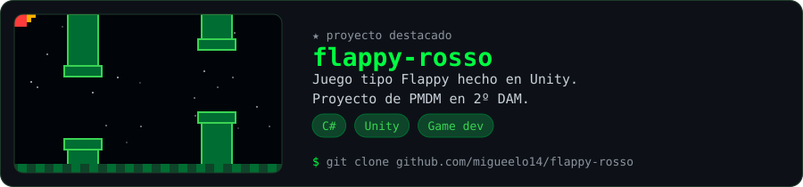

    

 

### `>_` sobre_mí

### `>_` tech_stack

  

### `>_` proyectos

### `>_` stats

<picture>
  <source media="(prefers-color-scheme: dark)" srcset="https://raw.githubusercontent.com/migueelo14/migueelo14/output/snake-dark.svg"/>
  <source media="(prefers-color-scheme: light)" srcset="https://raw.githubusercontent.com/migueelo14/migueelo14/output/snake-light.svg"/>
  
</picture>

### `>_` contacto

  
  <!-- Cuando quieras añadir más redes, descomenta y pon tu enlace:
  
  
  -->

